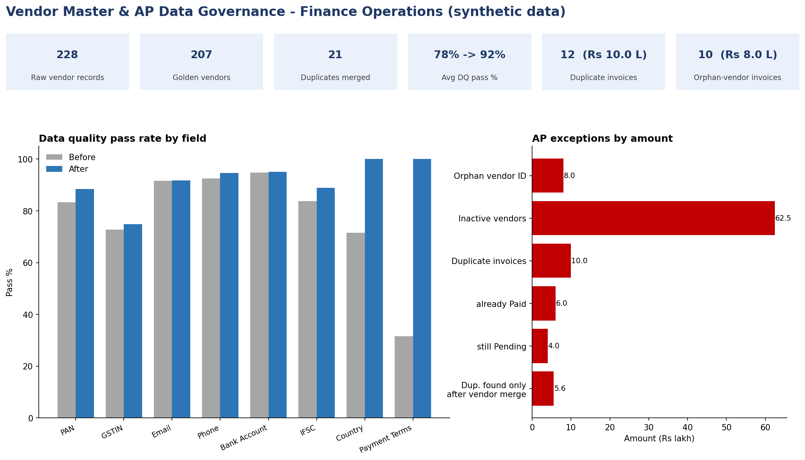

# Vendor Master Data Quality & AP Reconciliation (MDM) — Finance Operations



## Overview
In Finance Operations, wrong or duplicated **vendor master data** causes duplicate payments, failed bank transfers and
audit findings. This project cleans a vendor master, builds one **golden record** per vendor, and then uses those golden
records to reconcile accounts-payable (AP) invoices and expose payment risk.

> **Data note:** all data is **synthetic** (fictional vendors, PAN/GSTIN/bank numbers and amounts), generated with a fixed
> random seed so results are reproducible. No real company or person is represented.

## Business questions answered
1. How clean is the vendor master today, field by field?
2. Which vendor records are duplicates, and which one should survive?
3. Which invoices point to vendors that don't exist, or to inactive vendors?
4. How many duplicate invoices exist, and how many were only visible **after** merging duplicate vendors?
5. Which vendors need a data steward to act before the next payment run?

## Dataset
| Table | Rows | Key columns |
|---|---|---|
| `vendor_master_raw.csv` | 228 | Vendor_ID, Vendor_Name, PAN, GSTIN, Email, Phone, Bank_Account, IFSC, Country, Payment_Terms, Status, Created_Date |
| `ap_invoices_raw.csv` | 510 | Invoice_No, Vendor_ID, Invoice_Date, Invoice_Amount_INR, Payment_Status |

Issues deliberately present in the raw data: duplicate vendors (name variants, abbreviations, typos), missing/invalid PAN,
GSTIN that doesn't match PAN, bad email/phone/IFSC formats, inconsistent country and payment-term spellings, orphan
vendor IDs on invoices, and duplicate invoice submissions.

## Approach
1. **Profile & validate** — 8 field rules + 4 reconciliation rules .
2. **Standardise** — case, spacing, phone format (`+91 XXXXXXXXXX`), country (`India`), payment terms (`Net 30`). Missing values are **never invented**.
3. **De-duplicate** — records merge when the *normalised name* matches (case, punctuation, Pvt/Private/Ltd/Limited/LLP ignored) **or** the *valid PAN* matches.
4. **Survivorship** — the most complete record survives; blank/invalid fields are filled from the best valid value in the duplicate group.
5. **Near-duplicate review** — fuzzy name matches (similarity ≥ 0.90) are listed for a human, **not** auto-merged.
6. **ID mapping** — every raw `Vendor_ID` maps to a `Golden_Vendor_ID` (audit trail).
7. **AP reconciliation** — invoices are mapped to golden vendors; orphan, inactive and duplicate invoices are flagged.
8. **Steward queue** — unresolved issues are prioritised (High = PAN / GSTIN / bank / IFSC problems that affect payments).

## Key results
| Metric | Result |
|---|---|
| Raw → golden vendor records | 228 → 207 (21 duplicates merged) |
| Average field pass rate | 77.7% → 91.7% |
| Records with zero issues | 11.8% → 58.9% |
| Largest gains | Payment terms 31.6% → 100%, Country 71.5% → 100% |
| Vendors still needing steward action | 85 (71 High priority) |
| Near-duplicate pairs for review | 9 (some are look-alikes with different PANs, e.g. *Western* vs *Eastern*) |
| Invoices with vendor ID not in master | 10 (₹8.0 lakh) |
| Duplicate invoices detected | 12 (₹10.0 lakh): 6 already paid, 6 still pending |
| Duplicates visible **only after** vendor merge | 6 (₹5.6 lakh) — missed if checked by raw Vendor_ID |

**Insight:** half of the detected duplicate invoices were hidden because the same vendor existed under two IDs — a direct
argument for master-data consolidation before payment runs.

## Limitations (stated honestly)
- Validation is **format-level**. There is no live check against Income Tax / GST portals or a bank, and the GSTIN check-digit is not verified.
- 4 further duplicate invoices (₹5.4 lakh) sit under *near-duplicate* vendors that are pending steward review, so they are not yet flagged.
- "Inactive vendor" invoices are flagged for review only; the data has no deactivation date, so not every one is necessarily a violation.
- Missing PAN/GSTIN/bank details need vendor documents; the pipeline routes them to the Steward Queue instead of guessing.

## Repository structure
```
mdm-vendor-data-quality-governance/
├── README.md
├── requirements.txt
├── data/
│   ├── raw/            vendor_master_raw.csv, ap_invoices_raw.csv
│   └── processed/      vendor_master_golden.csv, vendor_id_map.csv,
│                       duplicate_review_candidates.csv, steward_action_queue.csv, ...
├── src/
│   ├── dq_rules.py                 validation + cleaning functions
│   ├── 01_generate_data.py         synthetic data generator (seeded)
│   ├── 02_clean_and_dedupe.py      standardise, dedupe, golden records
│   ├── 03_build_workbook.py        Excel workbook with live formulas
│   ├── 04_verify.py                cross-checks Excel formulas vs Python
│   └── 05_make_dashboard_png.py    dashboard image
├── excel/MDM_Vendor_DQ_Governance.xlsx
├── docs/               dq_rules.md, data_dictionary.md
└── images/dashboard_overview.png
```

## How to run
```bash
pip install -r requirements.txt
python src/01_generate_data.py
python src/02_clean_and_dedupe.py
python src/03_build_workbook.py
# open the workbook in Excel once and save (or recalculate with LibreOffice) so formula values are cached
python src/04_verify.py
python src/05_make_dashboard_png.py
```
Or simply open `excel/MDM_Vendor_DQ_Governance.xlsx` (sheets: Dashboard, DQ_Scorecard, DQ_Rules, Vendor_Master_Raw,
Vendor_Master_Golden, Vendor_ID_Map, Duplicate_Review, Steward_Queue, AP_Invoices_Recon).

## Skills demonstrated
Master data management · data quality rules · de-duplication & survivorship · golden record creation · reconciliation ·
Excel (SUMPRODUCT, COUNTIFS, INDEX/MATCH, conditional formatting, charts) · Python (pandas, difflib) · data governance
(audit trail, steward workflow) · Finance Operations (procure-to-pay, duplicate-payment risk)

## Author
Abhishek N
